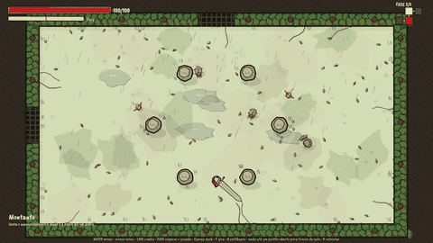
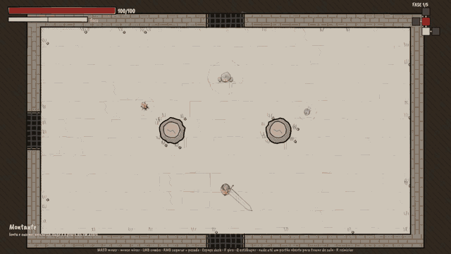
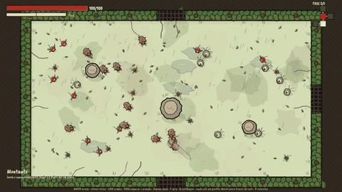
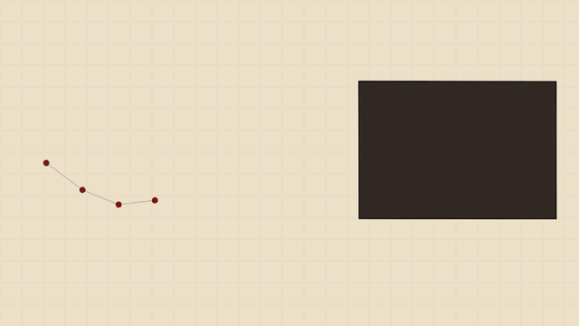
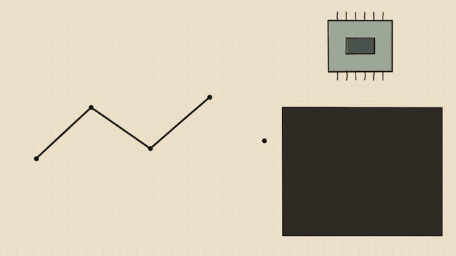
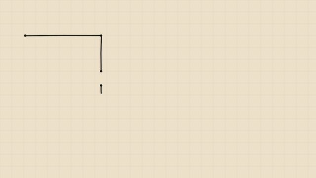
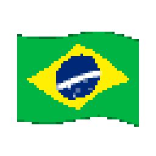

# Prisma Blade 光刃

Hack-and-slash roguelike top-down feito em Godot 4.7 .NET (C#), com cara de caderno de esboços desenhado à tinta.
**Não tem nenhum sprite.** Cada personagem, arma, monstro, chão e gota de chuva é traço de tinta gerado em código
e redesenhado 10 vezes por segundo, para tremer como animação feita à mão.

> Projeto experimental. O código está aberto para estudo.



## O jogo

- **Run em salas:** cada fase é uma grade de salas (luta, elite, tesouro e chefe) gerada a partir de uma semente.
  Ao entrar numa sala de luta os portões fecham; derrotar o guardião abre os portões de novo.
- **Cinco fases, cinco biomas:** 牢 Masmorra, 森 Floresta Chuvosa, 灰 Cavernas de Cinza, 沼 Pântano e 晶 Templo de Cristal,
  cada um com chão, papel e clima próprios.
- **Oito armas:** Espada Longa, Montante, Adagas Gêmeas, Foice, Katana do Eco, Lâmina Rúnica, Lança e Martelo de Guerra.
  Ao descer de fase, você escolhe uma de três espadas novas.
- **Combate com peso:** combo leve, golpe pesado carregado, dash com **dash perfeito** (o tempo desacelera),
  fratura e estilhaçar em cadeia, quebra de guarda (破), crítico (会心), rebater tiros e arremessar inimigos na parede.
- **Monstros:** dos pequenos (espinhos, orbes, bombardeiros, escudeiros) aos grandes, como o Ogro e a Aranha-mãe,
  que põe ovos.

| | |
|---|---|
|  |  |
| Os cinco biomas | 30+ monstros a 60 quadros por segundo |

## Como a tinta é desenhada

Todo traço é uma lista de pontos com um tremor próprio (a semente de cada forma), recalculado a cada 6 quadros.
O primeiro grande problema foi de desempenho: com 30 monstros, cada traço virava um pedido separado para a placa
de vídeo, milhares por quadro, e o jogo caía para 8 FPS. A solução (`scripts/InkBatch.cs`, ADR 0013) junta toda a
tinta de uma camada em **um pedido só**: a linha vira uma faixa de triângulos pelas normais de cada ponto. O quadro
caiu de 133 ms para 3,5 ms.

| | |
|---|---|
|  |  |
| A linha que "ferve" (`Ink.Boil`) | Linha → normais → triângulos → um pedido |



A mesma ideia do DOOM (1993): desenhar só o necessário e manter a lógica do jogo num ritmo fixo (60 Hz aqui),
separada do desenho.

## Controles

| Ação | Teclado + mouse | Controle |
|---|---|---|
| Mover | WASD / setas | analógico esquerdo |
| Mirar | mouse | analógico direito |
| Combo leve | LMB / J | X |
| Golpe pesado (segure para carregar) | RMB / K | Y |
| Dash | Espaço / Shift | A / RB |
| Estilhaçar (gasta foco) | Q / E / L | B / RT |
| Giro especial (custa vida) | F / botão do meio | LB |
| Trocar de sala | ande até um portão aberto | |
| Reiniciar | R | Back |
| Pausa | Esc | Start |

## Como rodar

**Requisitos**
- [Godot 4.7.1 .NET](https://godotengine.org/download) (a versão *.NET*, não a padrão);
- [.NET SDK 10](https://dotnet.microsoft.com/download) (a versão exata está em `global.json`);
- Node.js 18+, só para o script de verificação.

**Jogar**
1. Clone o repositório.
2. Rode `dotnet build PrismaBlade.csproj` uma vez.
3. Abra o `project.godot` no Godot .NET e aperte F5. Pela linha de comando:
   ```
   godot --path .
   ```

**Verificar** (build, testes e checagem do jogo sem janela):
```
node tools/verify.mjs
```
O script procura o Godot em `~/Downloads/Godot_v4.7.1-stable_mono_win64/`. Em outro lugar, aponte a variável
`GODOT` para o `*_console.exe` (ou o binário do Godot no Linux/macOS). Os testes rodam sem som
(`--audio-driver Dummy`). Com `--gpu`, ele também salva screenshots em `test-results/`.

## Estrutura

- `src/Prisma.Sim`: as regras do jogo, sem Godot, determinísticas a 60 Hz. `Tune.cs` tem os números,
  `Weapons.cs` as armas, `Enemies.cs` os monstros e `Dungeon.cs` as salas e fases.
- `tests/Prisma.Sim.Tests`: testes xUnit das regras.
- `scripts/`: a parte Godot.
  - `Ink.cs`: o pincel;
  - `InkBatch.cs`: a tinta em lote;
  - `MainArt.cs`: personagens, armas e criaturas;
  - `Floor.cs`, `Stains.cs` e `Weather.cs`: chão, manchas e clima;
  - `Hud.cs`, `Fx.cs` e `Sfx.cs`: HUD, efeitos e som.
- `scripts/Video/` e `scenes/video/`: a cena que filmou o devlog (veja abaixo).
- `assets/`: sons, músicas e texturas de pedra e partículas (todos CC0) e fontes (OFL); a origem de cada um está em `docs/ASSET_SOURCES.md`.

## O vídeo de devlog

O devlog foi filmado pelo próprio jogo, com o Movie Maker do Godot. Um piloto automático joga, as animações do quadro
desenham a técnica e digitam o código real, e uma pincelada de tinta cobre cada corte (ADR 0017). A narração não está
no repositório. Para filmar com a sua própria narração, ponha `narracao.wav` e `narracao.json` em
`~/Videos/PrismaBlade/` e rode:
```
godot --path . --audio-driver Dummy --resolution 1920x1080 --fixed-fps 60 --write-movie devlog.avi res://scenes/video/Devlog.tscn
```

## Documentação

- `docs/adr/`: o registro de decisões (ADRs).
- `docs/ART_STYLE.md`: o estilo de arte e como cada coisa é desenhada.
- `docs/ASSET_SOURCES.md`: a origem e a licença de cada som e fonte.

## Licença

O código está aberto para estudo, mas **não é open source**: ele usa a
[PolyForm Noncommercial 1.0.0](LICENSE.md). Você pode ler, estudar, modificar, usar e compartilhar para fins não comerciais
(pessoais, de estudo, pesquisa ou de organizações sem fins lucrativos), mantendo a licença e o aviso de copyright. **Não é permitido** vender, lançar ou publicar o jogo (ou uma versão dele) com fins comerciais.

A licença não dá nenhum direito comercial. Esses direitos continuam com o autor, e o nome "Prisma Blade" não pode ser
usado para identificar outros jogos. Sons e fontes de terceiros seguem as próprias licenças, listadas em
`docs/ASSET_SOURCES.md`. Contribuições (pull requests) só são aceitas com um acordo à parte que permita ao autor usá-las
também em uma versão comercial do jogo.

---

<p align="center">
  <br>
  <b>MADE BY BRAZILIAN ENGINEERS</b><br>
  <sub>A bandeira foi desenhada pelo <a href="https://github.com/devleor/inkwake">Inkwake</a>, o gerador de efeitos pintados do mesmo autor.</sub>
</p>
